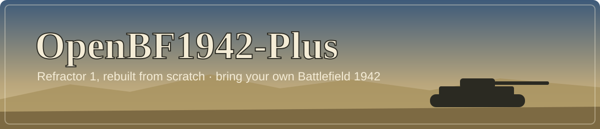
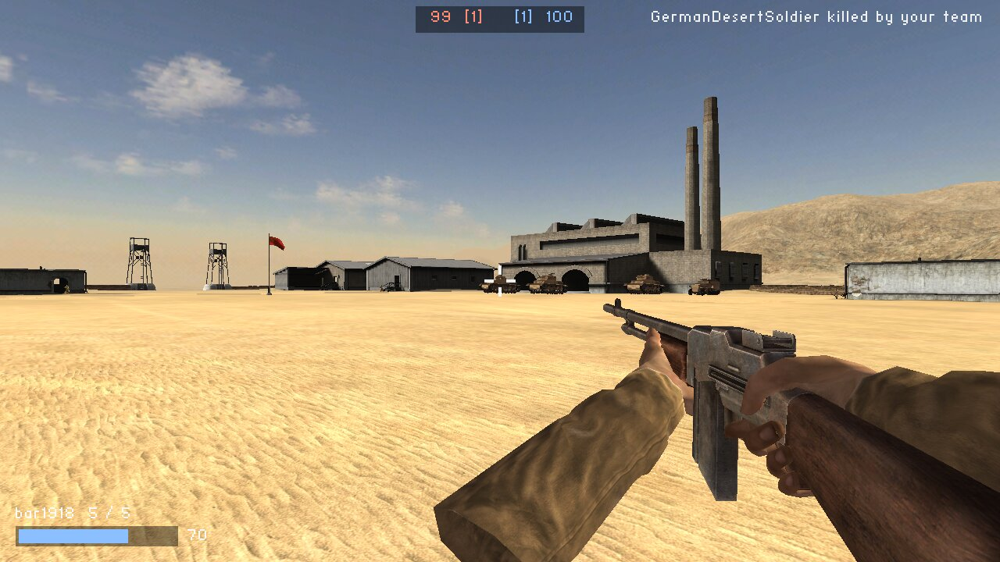
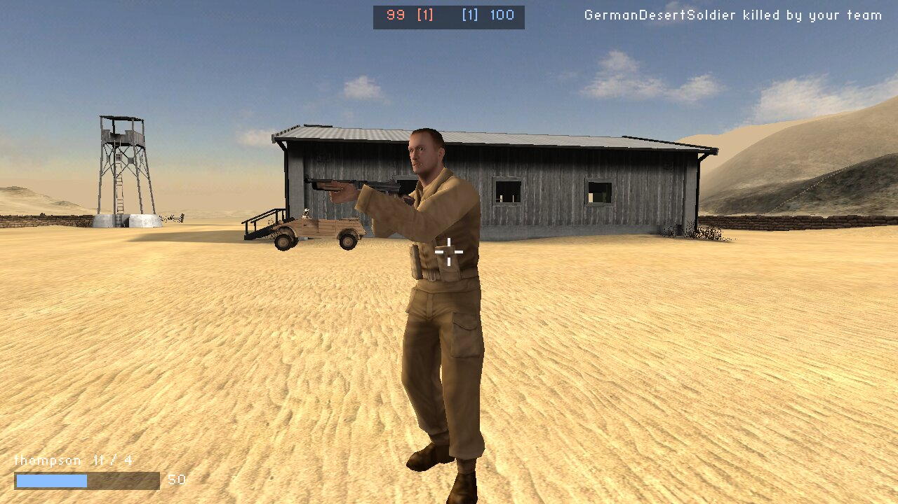
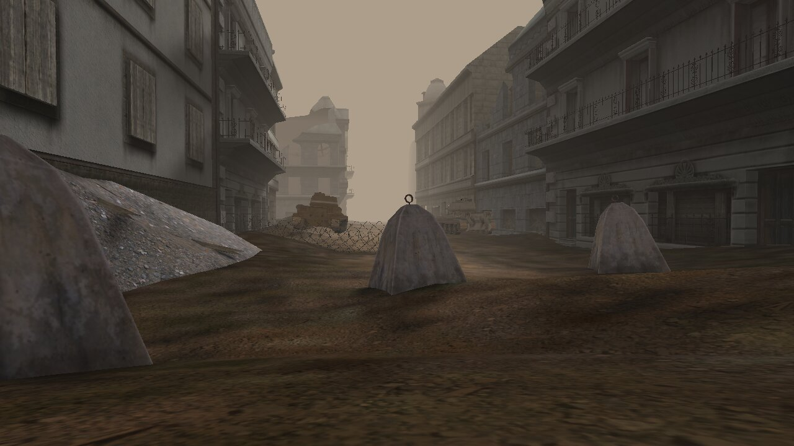

# OpenBF1942-Plus

<p align="center"></p>


[Español](README.es.md) · [English](README.md) · [Português](README.pt.md) · [Français](README.fr.md) · [Deutsch](README.de.md) · **Русский**

**Battlefield 1942 на новом движке.** OpenBF1942-Plus — это реимплементация методом «чистой комнаты» движка Refractor 1, на котором работает Battlefield 1942, написанная с нуля: она читает файлы самой игры из вашей установки и запускает их на современных системах. Цель — играть вместе с оригинальной игрой и против неё: оригинальные клиенты на нашем сервере, наш клиент на оригинальных серверах.

<table>
  <tr>
    <td></td>
    <td></td>
  </tr>
  <tr>
    <td colspan="2"></td>
  </tr>
</table>
<p align="center"><sub>Эль-Аламейн и Берлин, отрисованные OpenBF1942-Plus из файлов розничной версии игры.</sub></p>

## Что работает сейчас

- **Каждый уровень Battlefield 1942, Road to Rome и Secret Weapons of WWII загружается и отрисовывается**: рельеф, здания, деревья, вода, небо, туман и освещение по собственным настройкам каждого уровня.
- **Раунд в режиме Conquest против ботов** на любом уровне: флаги, тикеты, наборы снаряжения, магазины и перезарядка, гранаты, мины и подрывные заряды, пункты снабжения, присед и положение лёжа, парашюты, вид от первого и третьего лица.
- **Техника**: машины, танки, самолёты и катера, которыми можно управлять, с местами для стрелков и пассажиров; боты водят наземную технику и десантные катера и стреляют из их орудий.
- **Звук и HUD** из звуковых скриптов и шрифтов игры.
- **Сравнение с оригинальным клиентом** в одних и тех же точках Берлина и Эль-Аламейна: здания, дымка, небо, техника и песок в пределах примерно 15 %.
- **Исследование сети**: записана сессия оригинальных клиента и сервера; задокументирован протокол запросов к серверу.

> [!NOTE]
> **Ранний прототип.** Человеком проверены лишь небольшие части, многие правила — догадки, и ничего не откалибровано. Нет меню, пока нет мультиплеера, а улицы Берлина всё ещё темнее, чем в оригинале.

> [!IMPORTANT]
> **Игровой контент не включён — используйте свои данные.** Этот репозиторий содержит только исходный код: никаких исполняемых файлов, архивов, карт, моделей, текстур или звуков. Движок читает их из копии Battlefield 1942, которой **вы законно владеете**, здесь она обозначается как `<BF1942_DIR>`.

## Как играть

Готовых сборок пока нет: соберите движок (см. [Сборка](#сборка)) и укажите ему папку Battlefield 1942, ту, в которой есть `Mods/`:

```sh
build/obf_mapview "<BF1942_DIR>" bf1942 El_Alamein --play 2      # Conquest за команду 2, штурмовой набор
build/obf_mapview "<BF1942_DIR>" bf1942 Wake                     # свободная камера
build/obf_mapview "<BF1942_DIR>" bf1942 El_Alamein --drive Willy  # техника перед камерой
build/obf_sim "<BF1942_DIR>" bf1942 El_Alamein --play 2 --sim 600 # без окна: 10 минут Conquest, вывод в консоль
```

| Управление | |
|---|---|
| Движение, обзор | WASD, мышь (захвачена; F10 освобождает), shift — шаг, пробел — прыжок (в падении: раскрывает парашют) |
| Оружие | левая кнопка мыши — огонь, R — перезарядка, 1–9 — оружие набора, G — подрыв зарядов |
| Положение, вид | левый ctrl — присесть, Z — лечь, V — первое / третье лицо |
| Техника | E — сесть / выйти, F1–F8 — сменить место, WASD — вождение, мышь — наведение башен |
| Самолёты | W / S — тяга, стрелки — тангаж и крен, A / D — руль направления |
| Свободная камера | правая кнопка мыши — обзор, WASD / QE — движение, shift — быстро; C показывает меши коллизий; Esc — выход |

## Дорожная карта

Порядок, с обоснованиями и критериями завершения, описан в [docs/roadmap/roadmap.md](docs/roadmap/roadmap.md):

1. **Консолидация** (готово): игра как библиотека, рендерер и тонкие исполняемые файлы; CI.
2. **Исследование сетевого протокола** (записана одна сессия): расшифровать трафик оригинальных клиента и сервера, параллельно со следующими шагами.
3. **Навигация ИИ**, **аудио**, **HUD** (первые части готовы).
4. **Полноценные солдаты и оружие** (в основном готово), **экипажи техники** (суша и море готовы, пилоты в работе), **эффекты**.
5. **Точность воспроизведения**: измерить оригинал и откалибровать.
6. **Игровые режимы**, **меню**.
7. **Сеть**: собственные сервер и клиент, затем совместная игра с оригиналом.
8. **Рендеринг**, **распространение** (сборки для Windows и Linux, широкий экран, моды).

## Для участников

Важна любая помощь: попробовать и сообщить, что не так, сравнить с оригинальной игрой или написать код. Техническая документация, на английском, начинается с [docs/README.md](docs/README.md): форматы файлов, архитектурные решения и известный технический долг. [AGENTS.md](AGENTS.md) — точка входа для ИИ-агентов, пишущих код.

## Сборка

C++17, CMake, SDL2, OpenGL 3.3 (libepoxy) и Jolt Physics, который CMake скачивает при первой конфигурации. В Debian или Ubuntu:

```sh
sudo apt install cmake g++ git libsdl2-dev libepoxy-dev
cmake -S . -B build && cmake --build build -j
ctest --test-dir build
# -> build/obf_mapview (окно), build/obf_sim (без окна)
```

<details>
<summary><b>Инструменты на Python</b></summary>

Читатели форматов игры, только стандартная библиотека Python 3.

```sh
python3 tools/rfa.py list    "<BF1942_DIR>/Mods/bf1942/Archives/ai.rfa"
python3 tools/rfa.py extract "<BF1942_DIR>/Mods/bf1942/Archives/ai.rfa" out/
python3 tools/con.py "<BF1942_DIR>" bf1942 Wake    # загрузить уровень, вывести сводку
python3 tools/sm.py "<BF1942_DIR>" bf1942 standardMesh/willy_hul_m1 out/jeep   # OBJ + текстуры
python3 -m unittest discover tools     # тесты
python3 tools/check_docs.py            # проверки документации
```

</details>

<details>
<summary><b>Что где находится</b></summary>

| Путь | Содержимое |
|---|---|
| `engine` | Движок на C++: архивы, скрипты, меши, рельеф, анимация, физика, правила игры, ИИ, аудио, HUD, рендерер и исполняемые файлы |
| `tools` | Читатели форматов на Python, проверка документации и их тесты |
| `docs/formats` | Спецификации файловых и сетевых форматов |
| `docs/architecture` | Слои, границы и архитектурные решения (ADR) |
| `docs/roadmap` | Дорожная карта и известный технический долг |
| `docs/ai` | Слой памяти для ИИ-агентов |

</details>

## Прозрачность

- **Кто поддерживает проект:** OpenGamePlus. Я люблю старые игры и хочу и дальше играть в Battlefield 1942 с друзьями на современных системах, на открытом движке, который сообщество сможет поддерживать.
- **Как ведётся работа:** я работаю с [Claude Code](https://claude.com/claude-code), ассистентом для программирования от Anthropic. Код и документация, включая этот README и его переводы, пишутся с его помощью. Коммиты, сделанные таким образом, содержат в сообщении строку `Co-Authored-By: Claude`, поэтому их можно найти в истории с помощью `git log`.
- **Чистая комната:** код оригинального движка не используется и не декомпилируется. Движок пишется на основе файлов данных игры и наблюдения за работой оригинальной игры.
- **Чем это не является:** это не официальный проект, он не связан с Electronic Arts или DICE. Он не содержит файлов игры.

## Уведомление

Это независимая реимплементация движка Refractor 1. Она не связана с Electronic Arts Inc., EA Digital Illusions CE (DICE) или их аффилированными лицами и не авторизована, не спонсируется и не одобрена ими.

«Battlefield» и «Battlefield 1942» — товарные знаки Electronic Arts Inc. В этом репозитории они используются только для идентификации и совместимости, чтобы описать, что запускает движок. Никаких прав на эти знаки не заявляется.

Этот проект не предоставляет защищённые авторским правом игровые данные и не помогает их получить. Чтобы использовать его с настоящим игровым контентом, вы должны предоставить файлы данных из копии Battlefield 1942, которой законно владеете.

Если вы правообладатель и считаете, что что-то здесь не должно распространяться, пожалуйста, откройте issue или свяжитесь с сопровождающим, и вопрос будет оперативно решён.

Скриншоты показывают контент Battlefield 1942, принадлежащий Electronic Arts Inc., исключительно для идентификации.

## Лицензия

[GNU Affero General Public License v3.0](LICENSE). Тот, кто распространяет движок или запускает изменённую версию как сетевой сервер для других, должен предоставить её исходный код под той же лицензией. Сторонние библиотеки сохраняют свои лицензии: SDL2 (zlib), libepoxy (MIT) и Jolt Physics (MIT).

## Благодарности

- [Jolt Physics](https://github.com/jrouwe/JoltPhysics), [SDL](https://www.libsdl.org/) и [libepoxy](https://github.com/anholt/libepoxy)
- Electronic Arts / DICE — за игру
