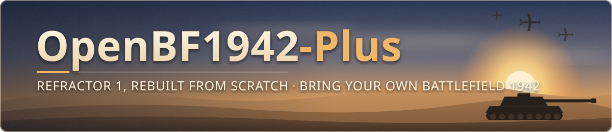

# Documentation index

Clean-room reimplementation of the Refractor 1 engine that runs Battlefield 1942 from your own installation. Start with the [system summary](ai/SYSTEM_SUMMARY.md) for what works today; the pages below hold the format specs, decisions and plans. The engine and tool reference is generated from `engine/` and `tools/`.

| Area | Document |
|---|---|
| Format coverage (what is left) | [formats/coverage.md](formats/coverage.md) |
| File formats | [formats/rfa.md](formats/rfa.md), [formats/con.md](formats/con.md), [formats/sm.md](formats/sm.md), [formats/terrain.md](formats/terrain.md), [formats/tm.md](formats/tm.md), [formats/anim.md](formats/anim.md), [formats/vehicles.md](formats/vehicles.md), [formats/weapons.md](formats/weapons.md), [formats/pathfinding.md](formats/pathfinding.md), [formats/sound.md](formats/sound.md), [formats/effects.md](formats/effects.md), [formats/hud.md](formats/hud.md), [formats/network.md](formats/network.md) |
| Architecture decisions | [architecture/adr/](architecture/adr/README.md) |
| Module boundaries | [architecture/boundaries.md](architecture/boundaries.md) |
| Roadmap (order, exit checks) | [roadmap/roadmap.md](roadmap/roadmap.md) |
| Debt, risks, open questions | [roadmap/debt.md](roadmap/debt.md) |
| Third-party research we use | [references.md](references.md) |
| AI memory layer | [ai/README_AI.md](ai/README_AI.md) |
